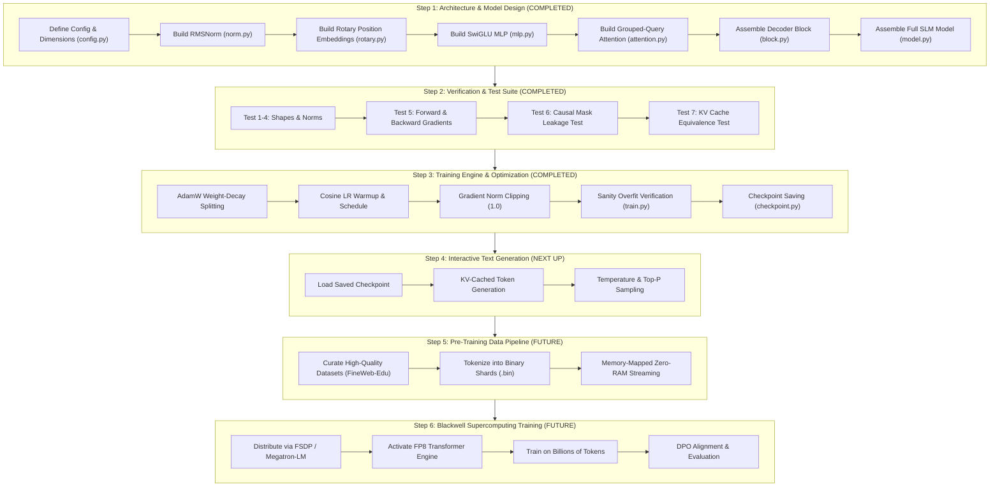

# 🗺️ SLM Project: Master Tracking Map & Knowledge Guide

> [!NOTE]
> **Project Context:** College Partnership with **IAIRO**  
> **Target Scale:** Small Language Model (SLM) ~1B to 1.5B parameters  
> **Target Hardware:** NVIDIA Blackwell GPUs (B200 / GB200)  
> **Development Environment:** Local Mac (MPS / CPU) & Zero-Budget Cloud (Colab / Kaggle)

---

## 🧭 Master Project Timeline & Roadmap

Here is the entire lifecycle of building an SLM from scratch. Look at the status tags to see exactly where we are right now:

---

## 🔍 Exhaustive File-by-File Breakdown

Below is the complete reference for every single file in your repository. For each file, we cover:
1. **Easy Intuition:** What it is in simple plain English.
2. **Deep Technical Mechanics:** The exact math, tensors, and GPU hardware reasons.
3. **Common Mistakes & What Can Break:** Exactly what bugs to look out for.

---

### 1. `config.py` — The Central Blueprint

* **Easy Intuition:**  
  Imagine building a skyscraper. Before you buy steel or cement, an architect draws blueprints stating: "20 floors, 16 pillars per floor, 3-meter ceiling height." `config.py` is that blueprint. It contains no math or operations; it only holds the measurements.
* **Deep Technical Mechanics:**  
  Uses Python's `@dataclass`. It defines:
  * `dim` (hidden dimension, e.g., 2048): The vector length representing each token.
  * `n_layers` (e.g., 16 or 22): How many transformer blocks are stacked vertically.
  * `n_heads` (16) & `n_kv_heads` (4): Defines Grouped-Query Attention (4 Query heads share 1 Key/Value head).
  * `multiple_of=128`: Ensures intermediate MLP dimensions are strictly divisible by 128. **Blackwell Tensor Cores** compute matrix multiplication in tiles of 64 or 128 numbers. If a dimension is not a multiple of 128, the GPU pads the matrix with zeros, wasting up to 40% of its computational speed!
* **What Can Go Wrong / Common Mistakes:**  
  * *Dimension Mismatch:* Choosing `dim=1000` with `n_heads=16` (`1000 / 16 = 62.5` $\rightarrow$ crashes PyTorch because head dimension must be an integer).
  * *Hardcoding numbers in other files:* If you change `dim` in `model.py` but forget to change it in `attention.py`, your model crashes. Always import dimensions from `config.py`.

---

### 2. `norm.py` — Root Mean Square Normalization (RMSNorm)

* **Easy Intuition:**  
  In a deep neural network, numbers get multiplied thousands of times. If numbers get too big ($1000 \times 1000$), they explode to infinity. If they get too small ($0.001 \times 0.001$), they vanish to zero. RMSNorm is a "volume knob" that rescales all numbers so they stay calm and stable (around -1.0 to +1.0).
* **Deep Technical Mechanics:**  
  Old models (like original 2017 Transformer or GPT-2) used **LayerNorm**:
  $$\text{LayerNorm}(x) = \frac{x - \mu}{\sqrt{\sigma^2 + \epsilon}} \odot \gamma + \beta$$
  LayerNorm calculates the mean ($\mu$), subtracts it, calculates variance ($\sigma^2$), and adds bias ($\beta$).  
  **RMSNorm** (used in Llama 3 and our SLM) simplifies this:
  $$\text{RMS}(x) = \sqrt{\frac{1}{d} \sum_{i=1}^d x_i^2 + \epsilon}, \quad \text{RMSNorm}(x) = \frac{x}{\text{RMS}(x)} \odot \gamma$$
  *Why?* Calculating the mean $\mu$ requires reading all numbers, summing them, and writing them back to memory. Skipping $\mu$ reduces GPU memory bandwidth round-trips by ~7% while maintaining identical training stability.
* **What Can Go Wrong / Common Mistakes:**  
  * *Division by Zero:* If all values in $x$ are zero, $\text{RMS}(x) = 0$. That is why we add a tiny `eps = 1e-5` inside the square root.
  * *Precision Underflow:* In mixed precision (FP16), numbers smaller than $10^{-5}$ become zero. In `norm.py`, we explicitly cast `x.float()` (FP32) to compute the variance safely before casting back.

---

### 3. `rotary.py` — Rotary Positional Embeddings (RoPE)

* **Easy Intuition:**  
  Transformers process all words in a sentence at the exact same millisecond. To the computer, *"The dog bit the cat"* and *"The cat bit the dog"* look identical unless we tell it the word order. RoPE is a mathematical clock: it rotates each word's vector by an angle based on where that word sits in the sentence.
* **Deep Technical Mechanics:**  
  Old models used **Absolute Positional Embeddings** (adding a static vector for pos 0, pos 1, etc.). This breaks if you test on longer sentences than training.  
  RoPE pairs vector coordinates $(x_1, x_2)$ into 2D planes and applies a 2D rotation matrix:
  $$\begin{pmatrix} x_1' \\ x_2' \end{pmatrix} = \begin{pmatrix} \cos(m\theta) & -\sin(m\theta) \\ \sin(m\theta) & \cos(m\theta) \end{pmatrix} \begin{pmatrix} x_1 \\ x_2 \end{pmatrix}$$
  where $m$ is the token position ($0, 1, 2, ...$) and $\theta$ is the frequency.  
  *Why is this brilliant?* When the Query vector at position $m$ multiplies the Key vector at position $n$, the dot product depends purely on $(m - n)$—the **relative distance** between the words!
* **What Can Go Wrong / Common Mistakes:**  
  * *Rotating the wrong tensor:* RoPE must **only** be applied to Query ($Q$) and Key ($K$). If you apply it to Value ($V$), the model's memory gets scrambled.
  * *Mismatching head dimensions:* Head dimension must be even (`dim % 2 == 0`) because coordinates are rotated in 2D pairs.

---

### 4. `mlp.py` — SwiGLU Feed-Forward Network

* **Easy Intuition:**  
  If the Attention layer is the communication channel (words talking to words), the MLP is the "individual thinking brain" of each word. It processes the context gathered by attention and synthesizes meaning.
* **Deep Technical Mechanics:**  
  Classic Transformers used a simple 2-layer MLP: $\text{ReLU}(x W_1) W_2$.  
  Modern SLMs use **SwiGLU** (Swish Gated Linear Unit):
  $$\text{SwiGLU}(x) = \left( \text{SiLU}(x W_{\text{gate}}) \odot (x W_{\text{up}}) \right) W_{\text{down}}$$
  * Three linear matrices: `gate_proj`, `up_proj`, and `down_proj`.
  * `SiLU` (Sigmoid Linear Unit) acts as a smooth, continuous gate that decides how much information passes through.
  * All `bias=False` to save parameters and stabilize training.
* **What Can Go Wrong / Common Mistakes:**  
  * *Forgetting the element-wise multiplication ($\odot$):* The gate projection and up projection must be multiplied together element-by-element before feeding into `down_proj`.
  * *Excessive memory consumption:* SwiGLU uses 3 matrices instead of 2. That is why intermediate dimension is calculated as $\frac{8}{3} \times \text{dim}$ rather than $4 \times \text{dim}$.

---

### 5. `attention.py` — Grouped-Query Attention (GQA) & KV-Cache

* **Easy Intuition:**  
  The core of the Transformer. For every word, it asks: *"Which other words should I pay attention to?"* When generating text, saving past answers in a memory box (**KV Cache**) prevents the model from recalculating past words over and over.
* **Deep Technical Mechanics:**  
  1. Computes $Q = x W_q$, $K = x W_k$, $V = x W_v$.
  2. In **GQA**, instead of having 16 Key and 16 Value heads, we only have 4 Key and 4 Value heads. Each KV head is shared across 4 Query heads (`repeat_kv`).
  3. Applies RoPE to $Q$ and $K$.
  4. Calls PyTorch's `F.scaled_dot_product_attention`, which automatically invokes **FlashAttention** (tiling the computation in fast GPU SRAM to bypass slow GPU DRAM).
* **What Can Go Wrong / Common Mistakes:**  
  * *Causal Mask Leakage:* Forgetting `is_causal=True` allows token 2 to look at token 5 during training. The model will appear to have 0 loss but will generate pure nonsense in inference.
  * *Using KV Cache in Training:* The KV cache should **never** be used during training; it is strictly an inference optimization.

---

### 6. `block.py` — The Transformer Decoder Block

* **Easy Intuition:**  
  A single repeating floor in our skyscraper. Each floor contains an Attention room, an MLP room, and elevators (**residual connections**) that skip floors.
* **Deep Technical Mechanics:**  
  Implements the **Pre-RMSNorm** structure:
  $$h = x + \text{Attention}(\text{RMSNorm}_1(x))$$
  $$\text{output} = h + \text{MLP}(\text{RMSNorm}_2(h))$$
  *Why Pre-Norm instead of Post-Norm?* In Post-Norm ($x = \text{Norm}(x + f(x))$), gradients must pass through every normalization layer backward, causing gradients to vanish in models deeper than 12 layers. Pre-Norm has an uninterrupted residual "highway" ($x + ...$) so gradients flow cleanly back to layer 1.
* **What Can Go Wrong / Common Mistakes:**  
  * *Normalizing the residual directly:* Do NOT do `x = RMSNorm(x + attn)`. The residual stream must remain untouched.

---

### 7. `model.py` — Full SLM Assembly

* **Easy Intuition:**  
  The complete machine. It accepts raw token IDs (`[101, 504, 99]`), turns them into vectors via the Embedding table, passes them through $N$ Transformer Blocks, and predicts vocabulary probabilities using the Language Model Head (`lm_head`).
* **Deep Technical Mechanics:**  
  * `embed_tokens`: Matrix of shape `[vocab_size, dim]`.
  * `layers`: `nn.ModuleList` of $N$ blocks.
  * `norm`: Final RMSNorm before logits.
  * `lm_head`: Linear projection from `dim` to `vocab_size`.
  * Loss computation: Flattens `logits` to `[batch * seq_len, vocab_size]` and computes Cross-Entropy Loss against `targets`.
* **What Can Go Wrong / Common Mistakes:**  
  * *Ignoring mask tokens:* Always use `ignore_index=-100` in cross-entropy so padded tokens don't penalize the model.

---

### 8. `tokenizer.py` — Language Translation

* **Easy Intuition:**  
  Computers cannot read letters; they only understand integers. The tokenizer chops text into sub-words and looks up their integer IDs in a dictionary.
* **Deep Technical Mechanics:**  
  * Uses Byte-Pair Encoding (BPE).
  * Converts `"Hello world"` $\rightarrow$ `[15496, 995]`.
  * Provides a fallback `SimpleCharTokenizer` for offline testing without internet.
* **What Can Go Wrong / The Real Error We Encountered:**  
  > [!WARNING]
  > **The Vocab Mismatch Bug:** If your model has `vocab_size=8000` but your tokenizer produces ID `14607`, PyTorch crashes with `index out of bounds`. Always ensure `config.vocab_size == tokenizer.vocab_size`.

---

### 9. `checkpoint.py` — Safe Saving & Loading

* **Easy Intuition:**  
  The "Save Game" button. If training takes 3 days and your computer crashes or reboots on day 2, you don't want to lose your work.
* **Deep Technical Mechanics:**  
  Saves a dictionary containing:
  * `model_state_dict`: All neural network weights.
  * `optimizer_state_dict`: The AdamW momentum buffers.
  * `step`: The exact training iteration count.
  * `config`: The exact architectural dataclass used, so the model can be reconstructed with 100% fidelity without guessing dimensions.
* **What Can Go Wrong:**  
  * *Saving only weights:* If you don't save the optimizer state, resuming training causes an initial loss spike because AdamW loses its running momentum averages.

---

### 10. `dataset.py` — Data Loading & Memory-Mapping

* **Easy Intuition:**  
  Feeds text into the model during training.
* **Deep Technical Mechanics:**  
  * Shifts tokens auto-regressively: if sequence is `[A, B, C, D]`, input $x$ is `[A, B, C]` and target $y$ is `[B, C, D]`.
  * Implements `MemmapDataset` using `numpy.memmap`: Reads tokens directly from binary files on the SSD on demand. This allows training on 50GB of text on a laptop with only 8GB of RAM!
* **What Can Go Wrong:**  
  * *Index off-by-one:* If input and target aren't shifted by exactly 1 position, the model learns the wrong objective (e.g. predicting the current word instead of the *next* word).

---

### 11. `generation.py` — Text Generation Engine

* **Easy Intuition:**  
  Takes a prompt (e.g. `"The universe is"`) and generates words one by one until it finishes.
* **Deep Technical Mechanics:**  
  * **Prefill Phase:** Runs the prompt through the model all at once to populate initial KV caches.
  * **Decode Phase:** Generates 1 token at a time using cached past keys/values.
  * **Sampling Modes:**
    * *Greedy:* Always picks the #1 most probable token (deterministic).
    * *Temperature:* Divides logits by $T$. High $T$ = creative/wild; low $T$ = focused/factual.
    * *Top-K:* Cuts off everything except the top $K$ choices.
    * *Top-P (Nucleus):* Dynamically keeps only tokens that make up the top $P\%$ cumulative probability mass.

---

### 12. `train.py` — The Training Engine

* **Easy Intuition:**  
  The personal trainer. It feeds text to the model, calculates how wrong the model was (loss), computes gradients via backpropagation, and nudges the weights using the AdamW optimizer.
* **Deep Technical Mechanics:**  
  * **Hardware Detection:** Automatically picks Apple Silicon GPU (`mps`), NVIDIA CUDA, or CPU.
  * **Weight-Decay Splitting:** Applies weight decay (0.1) to 2D matrix weights, but strictly excludes 1D RMSNorm scale parameters and biases to avoid shrinking normalization layers.
  * **Cosine Schedule with Warmup:** Slowly increases learning rate over the first 10 steps to prevent unstable shocks, then smoothly decays down according to a cosine curve.
  * **Gradient Clipping:** Caps gradient norms at `1.0` (`torch.nn.utils.clip_grad_norm_`) to prevent exploding gradients.

---

### 13. `test_model.py` — The 7 Architectural Verifications

* **Easy Intuition:**  
  The crash test facility. Before you put a car on the highway, you test the brakes, steering, and engine. This script runs 7 tests to guarantee the code is mathematically sound.
* **The 7 Tests Explained:**
  1. `test_rmsnorm`: Verifies output variance scales to ~1.0.
  2. `test_rope`: Verifies frequency table dimensions and 2D rotations.
  3. `test_swiglu`: Verifies gated MLP preserves dimensions.
  4. `test_gqa_attention`: Verifies Key/Value head repeating and KV cache creation.
  5. `test_model_forward_and_backward`: Verifies loss is positive and gradients flow to all weights.
  6. `test_causal_masking_leakage`: **The critical test.** Verifies that changing a future token does NOT alter earlier token predictions.
  7. `test_kv_cache_equivalence`: Verifies that fast KV-cached token generation produces numbers identical to computing the full sequence from scratch.

---

## 🚀 Summary Checklist: What We Did vs. What We Do Next

| Component / Step | Status | What was achieved |
| :--- | :--- | :--- |
| **Model Architecture** | ✅ **DONE** | 7 core files implemented with RoPE, RMSNorm, SwiGLU, and GQA. |
| **Architectural Tests** | ✅ **DONE** | All 7 unit tests passed cleanly on your Mac. |
| **Training Engine** | ✅ **DONE** | `train.py` built with AdamW, Cosine LR, gradient clipping, and overfit verification. |
| **Interactive Generation** | ⏳ **UP NEXT** | Load the saved checkpoint and watch the model generate text in real time. |
| **Binary Data Pipeline** | 📅 **FUTURE** | Tokenize large text corpora into memory-mapped `.bin` files for high-throughput training. |
| **Blackwell Training** | 📅 **FUTURE** | Scale up to multi-GPU FSDP on NVIDIA Blackwell hardware with IAIRO. |
